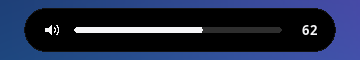
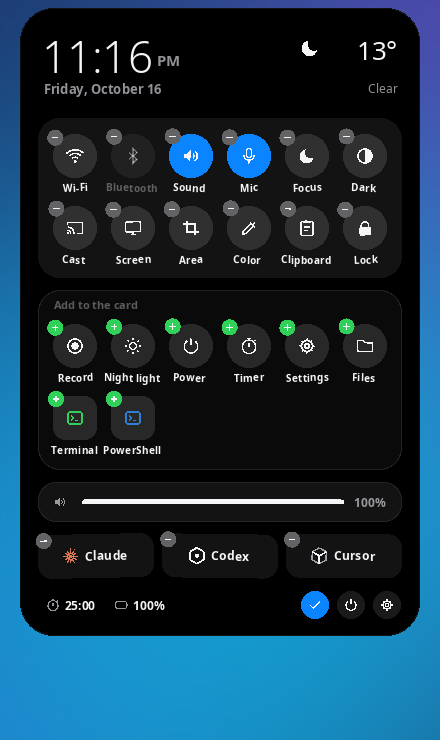
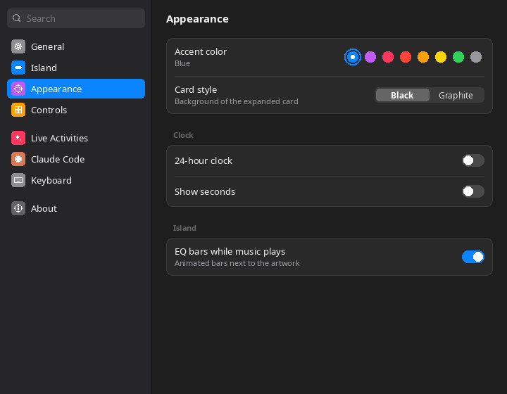
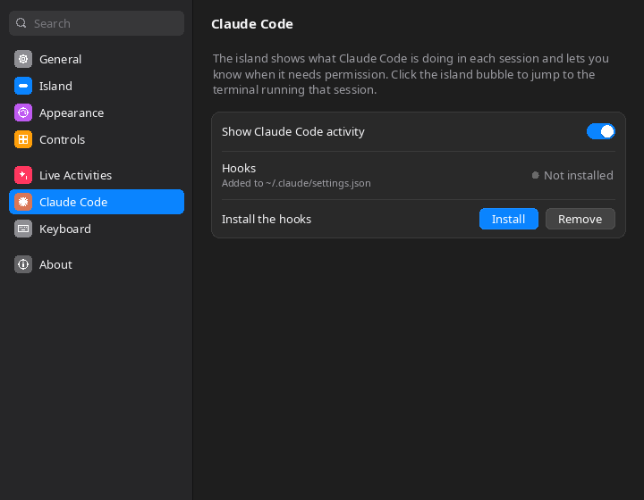

# Lost Island for Windows

A Dynamic Island for Windows 10 and 11, written in C++ with Win32, Direct2D, DirectWrite and WinRT. It is one small `.exe` with nothing to install, and it is the Windows version of [Lost Island for Sway](https://github.com/byte4day/lost-island-archcraft-sway).


## Install

1. Download `LostIsland-1.0.0-win64.zip` from [Releases](https://github.com/byte4day/lost-island-windows/releases/latest) and unzip it anywhere.
2. Run `LostIsland.exe`. The island appears at the top of your main display, and Settings opens the first time.
3. Optional: turn on **Start with Windows** in Settings › General.

Windows SmartScreen may warn about an unsigned app the first time. Choose **More info › Run anyway**.

## The island

- **Resting pill.** A black capsule, 37 px tall like the iPhone's island, with the Windows mark and the clock, or the clock and the weather. Switch the shape to **Notch** to hang it from the top edge like a MacBook.
- **Live activities.** The most important activity fills the pill, and the next one gets its own round bubble beside it:
  1. **Claude Code needs you.** The Claude spark and, in orange, what it is asking ("Allow Bash?").
  2. **Music.** Album art, title and EQ bars that move with the real output level, in the album's color. The source is Windows' media controls, so Spotify, browsers, Media Player and VLC all work.
  3. **Claude Code working.** A spinning spark and what it is doing ("Edit app.cpp", "Run tests"). **Done** stays for 8 seconds.
  4. **Downloads** from Chrome, Edge and Firefox in your Downloads folder, with the size received.
  5. **Focus timer.** A progress ring and the time left.
- **Peeks.** Volume, Caps Lock, plugging in the charger, a new track, a picked color and saved screenshots show for a moment and then go away.
- **Motion.** Every change of shape runs on a spring: the island overshoots a little and settles. Buttons press in, and edit mode jiggles. **Reduce motion** in Settings turns the overshoot off.

| Resting | Volume peek | Notch with a timer (orange accent) |
|---|---|---|
|  |  |  |

### Using it

- **Click** the pill to open the card. Click outside it or press <kbd>Esc</kbd> to close it.
- <kbd>Ctrl</kbd>+<kbd>Alt</kbd>+<kbd>I</kbd> opens the card from anywhere. You can change it in Settings › Keyboard.
- **Scroll** over the pill to change the volume, and **middle-click** to play or pause.
- **Right-click** the pill, or the tray icon, for the menu: open card, focus timer, Settings, quit.
- Click the **bubble** to jump to Claude Code's terminal, open the player, or pause the timer.

## The card

- **Music player.** Cover, title, artist, the app's name, a seek bar you can click, and previous, play and next. The player is tinted by the album art. When a player publishes no track length, the seek bar is hidden.
- **Claude Code sessions.** Each session with its project and what it is doing. Click one to bring its terminal to the front.
- **Controls.** Round buttons, blue when on: Wi-Fi, Bluetooth, Sound, Mic, Focus, Dark mode, Cast, Screen (full screenshot saved to `Pictures\Screenshots` and copied), Area (Windows' snipping overlay), Color picker with a magnifier, Clipboard history, Lock. Night light, Record, Files, Timer, Power and Settings can be added. Right-click a control to open its page in Windows Settings.
- **Volume and brightness** bars. Brightness shows on laptops (WMI) and on external monitors that support DDC/CI.
- **Launchers** for the Claude Code, Codex and Cursor CLIs, opened in Windows Terminal. Terminal and PowerShell can be added.
- **Info line.** Focus timer (click to start or pause, scroll to set 5 to 90 minutes), weather, battery, and the Edit, Power and Settings buttons.
- **Clipboard** lists the last 25 pieces of text you copied. Click one to copy it again. History is kept in memory only, and text that password managers mark as private is skipped.
- **Power** has Lock, Sign out, Sleep, Restart and Shut down. Every action except Lock asks for a second click within 4 seconds.



**Edit the card:** click the pencil, or press and hold any control. Drag a control onto another to move it, click − to remove it, and click + in the tray to add it. Click ✓ when you're done.

## Settings

Settings looks and works like macOS System Settings: a sidebar with search, grouped lists, switches, sliders, pop-up menus and accent colors. Every change applies right away.

| Page | What you can change |
|---|---|
| General | Start with Windows, open the card on hover, hide over fullscreen apps, reduce motion, reset |
| Island | Island or Notch shape (with a live preview), pill face, display (main or the one with the pointer), distance from top, size |
| Appearance | Accent color (the eight macOS colors), black or graphite card, 24-hour clock, seconds, EQ bars |
| Controls | Order, add and remove controls and launchers |
| Live Activities | Each activity and peek, focus timer length and chime, weather city and units |
| Claude Code | Install or remove the status hooks |
| Keyboard | The shortcut that opens the card |

 

Settings are saved in `%APPDATA%\LostIsland\config.json`.

## Claude Code status

Open Settings › Claude Code and click **Install**, or run:

```powershell
LostIsland.exe --setup-claude-status
```

It copies a small hook to `%LOCALAPPDATA%\LostIsland\LostIslandHook.exe`, backs up `~/.claude/settings.json`, and adds the hook to Claude Code's session events next to any hooks you already have. New sessions then report what they are doing. `--remove-claude-status` takes the hooks out again.

The hook writes one small file per session to `%LOCALAPPDATA%\LostIsland\claude-status\`, prints nothing, and always exits 0, so it never slows Claude Code down or adds text to the conversation.

## Command line

```text
LostIsland.exe                     start (or open Settings when already running)
LostIsland.exe --toggle            open or close the card
LostIsland.exe --timer             start or pause the focus timer
LostIsland.exe --settings [page]   open Settings (general, island, appearance, controls, activities, claude, keyboard, about)
LostIsland.exe --quit              quit
```

## How it works

- **One layered window.** The island is a top-most `WS_EX_LAYERED` window. Each frame is drawn with Direct2D into a 32-bit surface and handed to `UpdateLayeredWindow`, so transparent pixels click through to whatever is underneath. The window is only as tall as what it shows.
- **Springs.** Width, height, corner radius, content fade and the bubble are separate damped springs, stepped at about 60 fps only while something moves. At rest the island redraws once a second for the clock.
- **Services.** Each system service has a small module in `src/services/`:
  - Core Audio for volume, mute, mic and the output level.
  - Global System Media Transport Controls (WinRT) for now playing.
  - `Windows.Devices.Radios` for Wi-Fi and Bluetooth.
  - The WLAN API for the network name.
  - WMI or DDC/CI for brightness.
  - WinHTTP and wttr.in for weather.
  - A clipboard format listener for clipboard history.
  - Folder change notifications for downloads and Claude Code.

  Slow calls run on worker threads and post a message when something changes.
- **No WinRT projection.** The WinRT interfaces it needs are declared by hand in `src/services/winrt_abi.h`. Their IIDs and method order were taken from the Windows SDK metadata, and the generic IIDs were computed with the WinRT algorithm.
- **Icons are vectors** drawn in code in the style of SF Symbols, so they look the same on every Windows version and need no icon font.

## Build

On Windows with Visual Studio 2022 (Desktop C++ workload):

```powershell
cmake -B build -G "Visual Studio 17 2022" -A x64
cmake --build build --config Release
```

On Linux, cross-compile with [llvm-mingw](https://github.com/mstorsjo/llvm-mingw):

```sh
LLVM_MINGW=/path/to/llvm-mingw ./scripts/build.sh   # writes build/LostIsland.exe
```

Release 1.0.0 was built with llvm-mingw 20261006. The MinGW build links statically, so the `.exe` needs no extra DLLs. The Visual Studio route is set up in CMake but has not been tested yet.

## Limits

- Windows has no public way to switch Focus (Do Not Disturb) or Night light, so those buttons open their Settings pages.
- **Record** sends Snipping Tool's recording shortcut, which needs a current Windows 11.
- **Wi-Fi** and **Bluetooth** need a radio that Windows exposes as switchable. Otherwise the buttons open Settings.
- Notification banners are not shown. Reading other apps' notifications requires a packaged app with the notification listener capability.
- The screenshots in this README were rendered with the release build running under Wine on Linux. Wine does not clip rounded images, so album art appears square in them.
- The sample song and Claude request in the screenshots come from `LOSTISLAND_DEMO=1`, an environment variable that exists only for screenshots.

## Credits

Lost Island for Windows is by [byte4day](https://github.com/byte4day). It ports the design of [Lost Island for Sway](https://github.com/byte4day/lost-island-archcraft-sway), which grew out of [Marco Zorn's Lost Island](https://github.com/MarcoZorn/lost-island) (MIT). The island's proportions follow Apple's Live Activity guidelines for the Dynamic Island.

MIT License. See [LICENSE](LICENSE).
